<p align="center">
  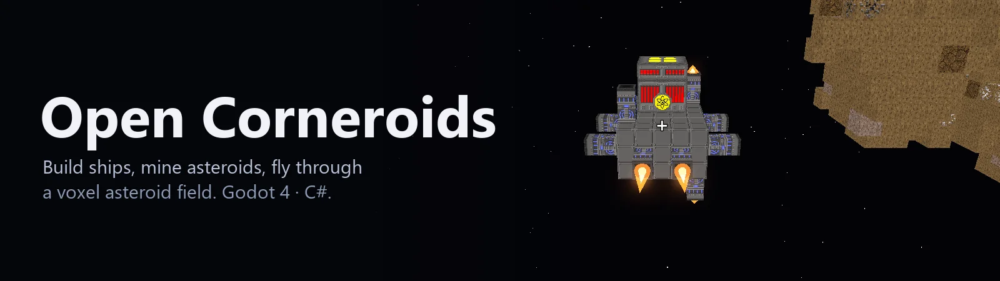
</p>

# Open Corneroids

[](https://github.com/olekkut/open-corneroids/actions/workflows/ci.yml)
[](https://github.com/olekkut/open-corneroids/releases)
[](LICENSE)
[](https://godotengine.org)
[](https://dotnet.microsoft.com)

A remake of **[Corneroids](http://www.corneroids.com/)**, Mikko Pulkki's 2012 voxel space sandbox, in **Godot 4** and
**C#**. Mine asteroids, craft parts, build a ship block by block, wire up its power and thrusters, and fly it through
the asteroid field.

It plays the original's own content: the vanilla 1.2.0 itemset and community mods like DarthNox's CADNR, with their
textures, are bundled, so the game runs straight out of the zip. Any other Corneroids itemset or texture pack can be
dropped in next to them.

<p align="center">
  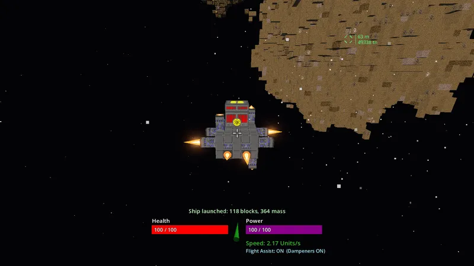
  <br><sub><b>Flying a ship</b>: the flight assistant fires whichever thrusters can push the way you ask</sub>
</p>

## Screenshots

<table>
  <tr>
    <td width="50%">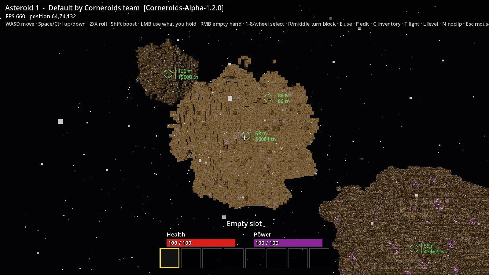<br><sub><b>The asteroid field</b>, every rock marked with its distance and mass</sub></td>
    <td width="50%">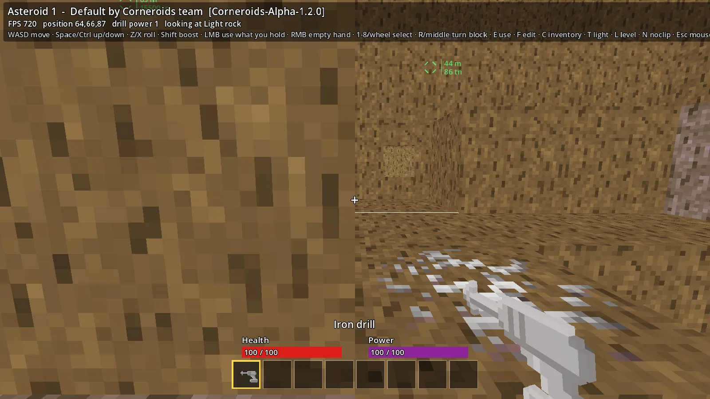<br><sub><b>Mining</b> with the iron drill; mined blocks float until you pick them up</sub></td>
  </tr>
  <tr>
    <td>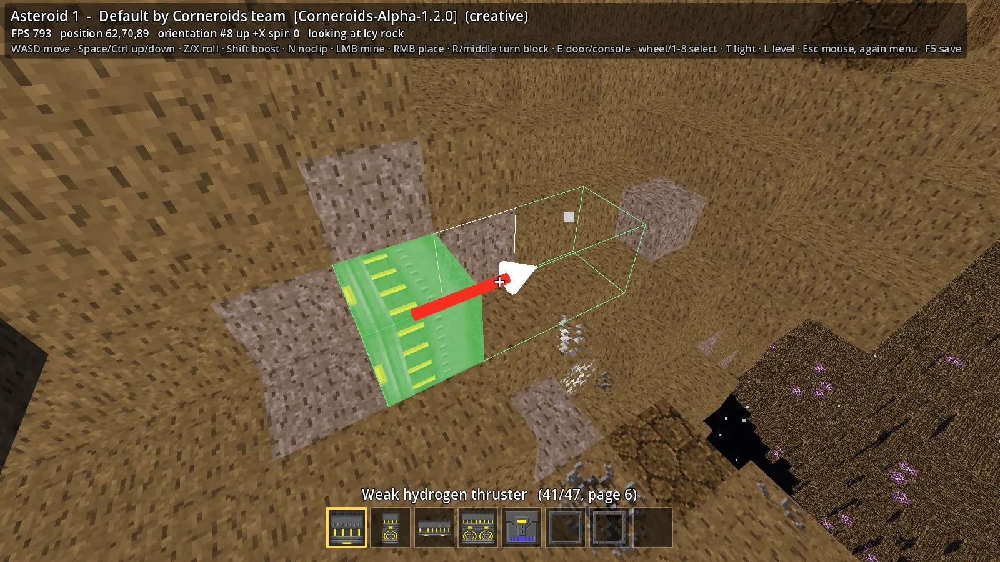<br><sub><b>Building</b>: a turned thruster's preview, footprint brackets and facing arrow</sub></td>
    <td>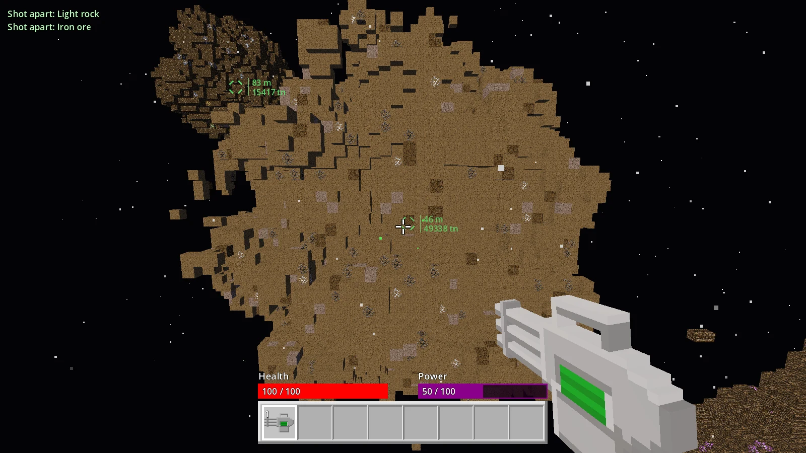<br><sub><b>Weapons</b>: the Thulium Minigun shooting rock apart</sub></td>
  </tr>
  <tr>
    <td>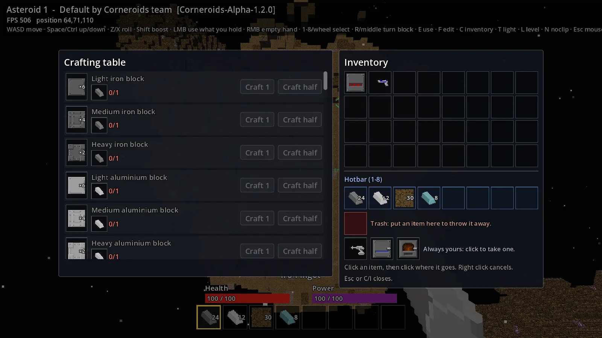<br><sub><b>Crafting</b> from the itemset's own blueprints</sub></td>
    <td>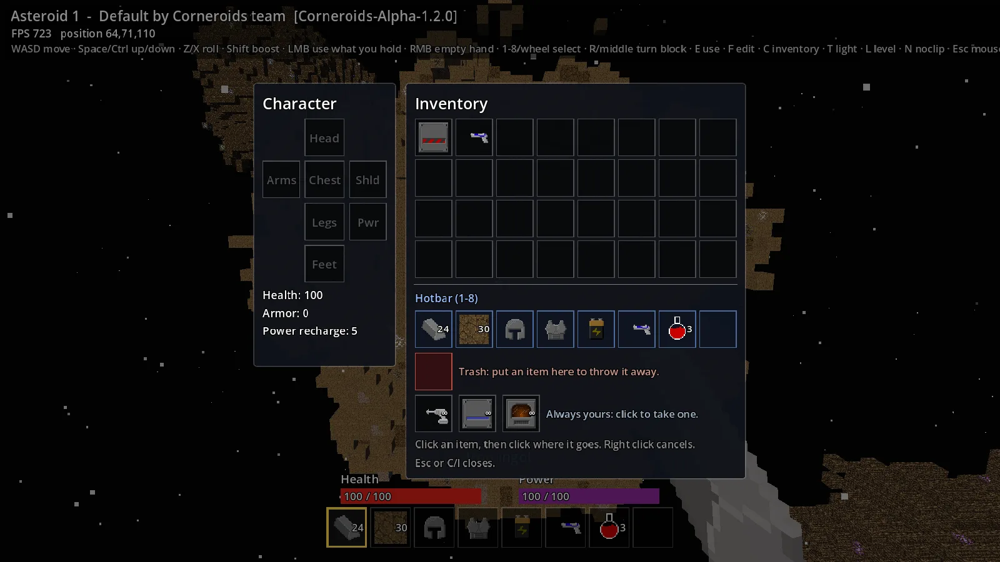<br><sub><b>Inventory</b>, equipment, trash and the endless starting tools</sub></td>
  </tr>
  <tr>
    <td>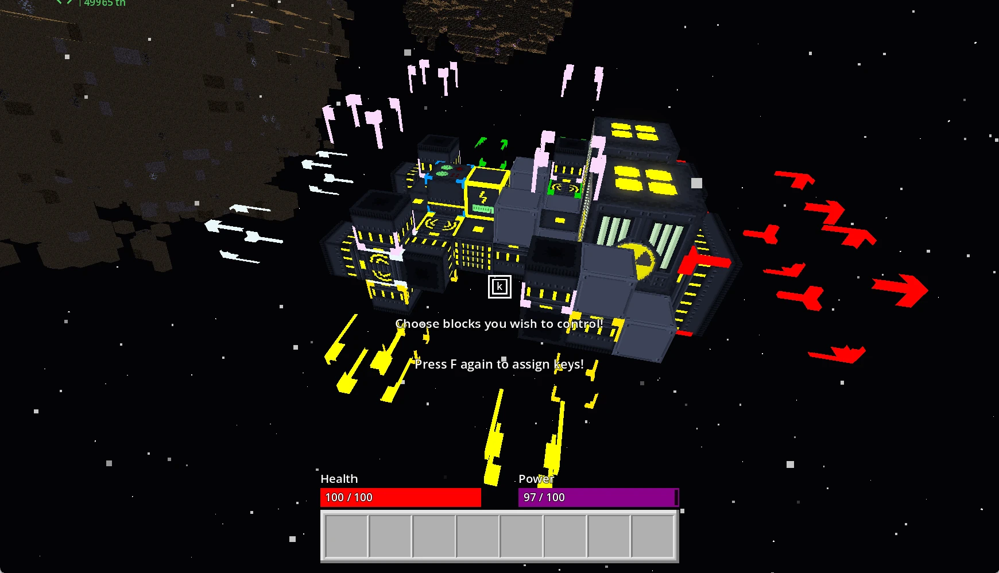<br><sub><b>Console binding</b>: colour-coded 8-corner brackets around bound thrusters and their exhaust space</sub></td>
    <td>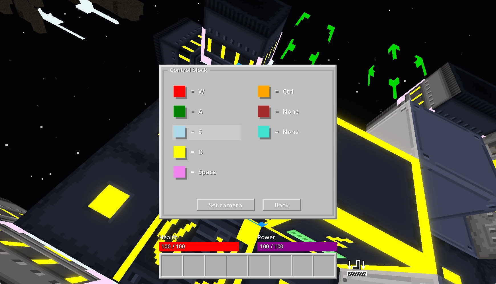<br><sub><b>Control block</b>: assigning keys and cameras to console colour groups</sub></td>
  </tr>
  <tr>
    <td>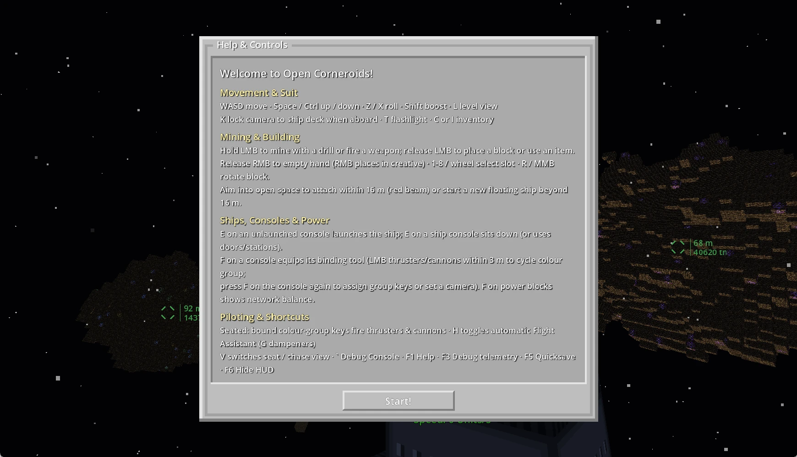<br><sub><b>Help &amp; Controls</b> (<code>F1</code>): quick in-game reference for movement, building and ships</sub></td>
    <td>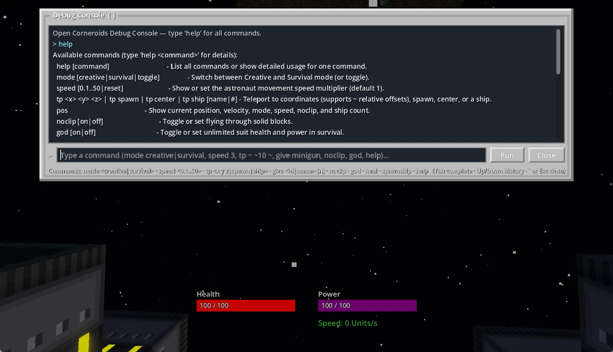<br><sub><b>Debug Console</b> (<code>`</code>): switch modes, change speed, teleport, spawn items and inspect ships</sub></td>
  </tr>
  <tr>
    <td>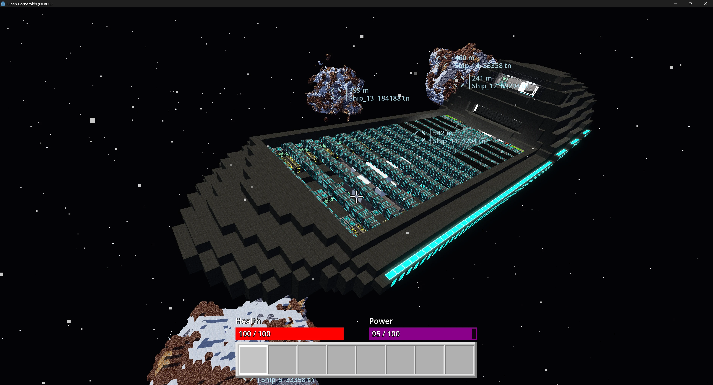<br><sub><b>Legacy .wrl maps</b> (experimental): loading original 2012 Corneroids worlds (e.g. <code>Adjuster.wrl</code>) with community itemsets</sub></td>
    <td>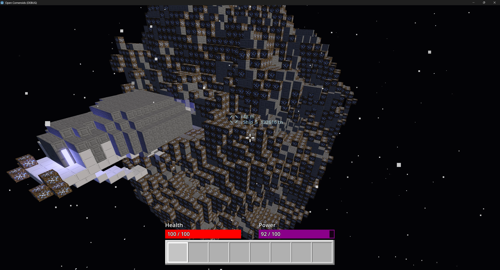<br><sub><b>Spacebox structure bridge</b> (<code>importship</code> / <code>exportship</code>): importing native <code>.sbs</code> ships from <a href="https://pasterlak.itch.io/spacebox">Spacebox</a></sub></td>
  </tr>
</table>

## Features

- **The original's content.** Loads Corneroids itemset XML and texture atlases as they are: vanilla 1.2.0, DarthNox's
  CADNR v21, Nav's Random Stuff and Sord's textures come bundled, and other mods load the same way, each checked
  and fingerprinted so saves know which itemset they belong to.
- **Survival.** Drill blocks with a drill strong enough for them, pick up what floats free, smelt and craft at the
  crafting table, ore furnace and mineral extractor, and keep your suit's health and power up with armor, power
  sources and consumables. Shots and hard crashes hurt, armor softens them, and dying sends you back 64 to 95 m away
  with your inventory intact.
- **Building.** Place single blocks and multi-block parts (thrusters, cannons, power blocks, doors) in any of 24
  orientations, with 8-corner footprint brackets, an outward facing/exhaust arrow, and empty-space placement that
  attaches to the nearest structure within 16 m (shown by a red attachment beam) or starts a new floating ship beyond it.
- **Ships.** Launch what you built or build straight in space, wire all-or-nothing power networks (`F` shows block count
  and power balance), and bind thrusters, cannons and cameras to colour-coded console groups (`F` on a console, then `F`
  again to assign keys). Fly with the original's console bindings by default, or press `H` for the optional automatic
  flight assistant; ships collide with rock and each other, and you ride along when you stand inside one.
- **Weapons.** Hand weapons and ship cannons fire the itemset's projectiles, which spend their damage on what they
  hit and fly on through what they break; gun consoles aim bound cannons where you look.
- **Creatures.** Mineral parasites eat the asteroids and charge you, swarm eggs hatch homing needles, and (if you turn
  them on) scavengers fly in shooting, all drawn with the original's models and textures.
- **Free flight.** Full six-degree movement in zero g: no fixed up, roll on Z and X, controls modelled on the
  original's.
- **Saves.** Worlds save their blocks, ships in flight, console bindings, your suit and inventory, and remember which
  itemset they need.
- **The original's menus.** The grey main menu over a flight through the stars, "Choose world" and "Create new
  world", and Options with the original's Gameplay, Graphics and Controls pages (key rebinding included), all saved to
  `config.cfg`; in game, Esc opens the Game menu and F1 the welcome window.
- **Yours to tune.** The original game's rules are the default, and the console changes almost any of them, the way
  Source engine games do: `sv_ricochet 1`, `sv_ship_max_speed 40`, `sv_mine_time_max 0.4`, `cl_fov 90`. World rules
  are saved with each world, preferences in `config.cfg`; `preset original` puts everything back, `exec` runs your own
  `.cfg` presets, and cheats such as `noclip`, `god` and `give` need `sv_cheats 1`. See the
  [guide](docs/guide.md#settings-console-variables).
- **Tested.** The content loader and the game rules live in plain C# libraries with 1,400+ automated tests; Godot only
  draws and takes input.
- **Backward compatibility & modding.** Loads original 2012 Corneroids `.wrl` SQLite 3 maps seamlessly alongside native
  `.ocworld` saves, discovers and loads mod packages directly from `.zip` archives in BYOA folders without manual
  extraction, and provides in-game import and export for Spacebox structure files (`.sbs`).

## Download and play

Grab the latest build for your system from the [**Releases page**](https://github.com/olekkut/open-corneroids/releases/latest).
Each download is the game with its data included, so there is nothing to install.

- **Windows:** unzip and run `OpenCorneroids.exe`.
- **Linux:** extract and run `OpenCorneroids.x86_64`.
- **macOS:** unzip, then right-click `Open Corneroids.app` and choose **Open** (the build isn't signed).

### Controls

| | |
|---|---|
| Move | `W` `A` `S` `D`, `Space` up, `Ctrl` down, `Shift` boost |
| Look and roll | mouse, `Z` / `X` roll, `L` level the view |
| Use what you hold | left mouse button (drill, shoot, place, consume); right button empties your hand |
| Hotbar | `1`–`8` or the mouse wheel |
| Turn the block to place | `R` or the middle mouse button |
| Use a block / edit it | `E` (consoles, crafting stations, doors) / `F` (console binding & key setup, power network info) |
| Inventory | `C` |
| Flashlight / fixed camera aboard | `T` / `K` |
| Console | `` ` `` (any setting by name, `find`, `differences`, `preset`, `exec`, `mode`, `kill`, `respawn`, `creatures`, `spawnship`, `importship`, `exportship`, `help`; with `sv_cheats 1` also `speed`, `tp`, `give`, `noclip`, `god`, `heal`) |
| Game menu (Options, Save and exit) | `Esc` |
| Welcome window / debug readout / hide HUD / save | `F1` / `F3` / `F6` / `F5` |

Flying a ship: by default, bound console group keys fire their thrusters and cannons while held (`V` seat/camera or
chase view, `E` to stand up, gun consoles aim bound cannons with the mouse). Press `H` to toggle the optional flight
assistant (`W` `S` forward/back, `A` `D` strafe, `Space` `Ctrl` up/down, mouse pitch/yaw, `Z` `X` roll, `G` dampeners,
left mouse button to fire all guns).

## Building from source

You need [Godot 4.7.2 .NET](https://godotengine.org/download) and the [.NET 8 SDK](https://dotnet.microsoft.com/download).

```bash
git clone https://github.com/olekkut/open-corneroids.git
cd open-corneroids
dotnet test OpenCorneroids.sln          # the loader and simulation tests
dotnet build game/OpenCorneroids.csproj # the game itself
```

Then open `game/project.godot` in Godot and press Play. On Windows, `Play.cmd` builds and starts the game in one
double-click once the Godot .NET folder sits in the repository. The [guide](docs/guide.md) covers every command-line
option, the worlds folder and the test hooks.

## How it's built

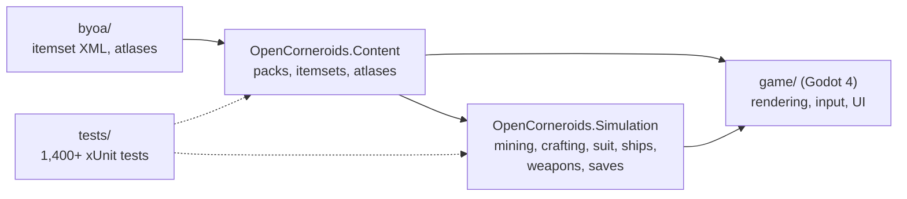

| Folder | What it holds |
|---|---|
| `src/OpenCorneroids.Content` | Finds packs, parses itemsets, resolves texture atlases, reads `.xnb` models and textures. No Godot. |
| `src/OpenCorneroids.Simulation` | Game rules: inventory, crafting, mining, suit, ship physics and power, weapons, settings, console, save format. No Godot. |
| `game/` | The Godot project: voxel meshing, the player, ships, HUD and windows. |
| `tests/` | Tests for both libraries, including checks against the bundled real data. |
| `tools/` | A command-line dump of what the loader finds. |
| `docs/` | The [guide](docs/guide.md) and design notes. |

## Roadmap

- [x] Loading the original itemsets, mods and texture packs (including direct `.zip` mod loading)
- [x] Backward compatibility: loading original Corneroids `.wrl` SQLite 3 maps
- [x] Spacebox structure import/export bridge (`.sbs` GZIP NBT)
- [x] Survival: mining, drops, crafting, inventory, suit, equipment
- [x] Building with orientations, multi-blocks and doors
- [x] Ships: launching, piloting, power, collisions, riding along
- [x] Weapons and ship cannons
- [x] Console button binding and placing blocks in empty space, as the original builds ships
- [x] Console settings: the original's rules by default, nearly every one tunable, saved per world
- [x] Damage to the player, armor, death and respawn
- [x] Creatures: mineral parasites, swarm eggs and needles (scavengers optional)
- [x] The original's menus and Options (Gameplay, Graphics, Controls with key rebinding), welcome window, Game menu
- [ ] Sound (the original has none; ours to add)
- [ ] Multiplayer

## Credits

Corneroids was created by **Mikko Pulkki**. The bundled mods are by **DarthNox** and **Chef Anon** (CADNR v21),
**Navar0nius** (Random Stuff) and **Sord213** (textures). The bundled game data and mods belong to their authors and
are not covered by this project's licence; they are included for preservation and will be removed on request. See
[CREDITS.md](CREDITS.md).

## License

The code is licensed under the [GNU General Public License v3.0](LICENSE).
